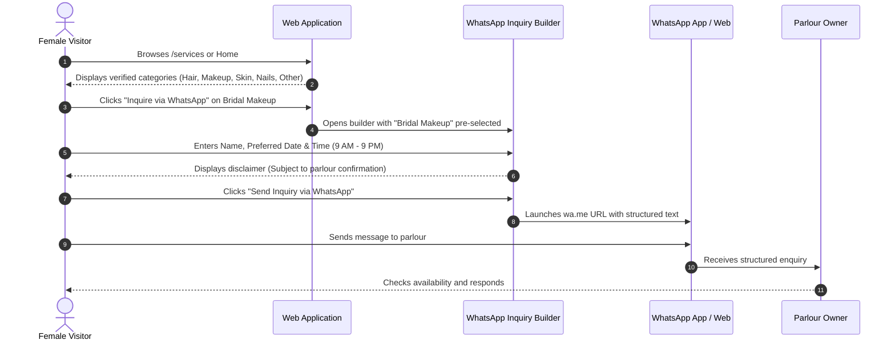
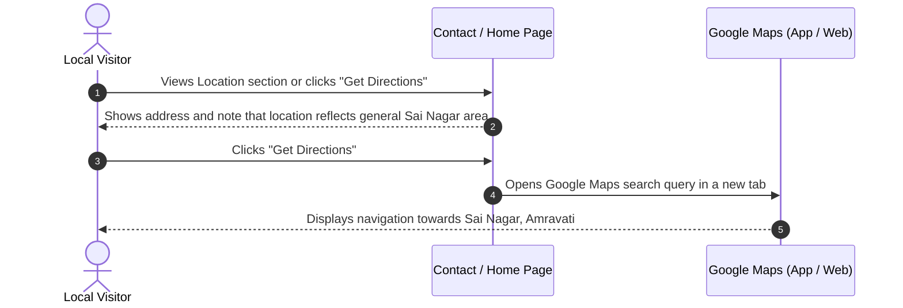
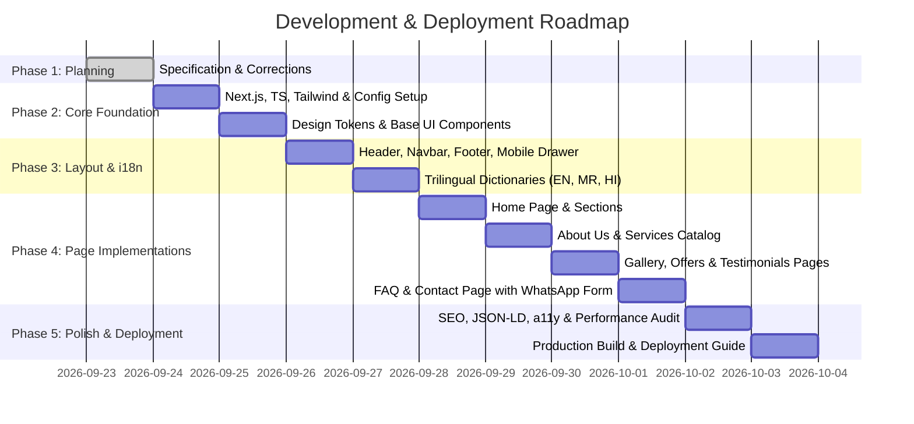

# PROJECT SPECIFICATION & ARCHITECTURAL BLUEPRINT
## Shraddha Beauty Parlour — Official Informational Website (Version 1.0)

**Document Version:** 1.3.0 (Visual Redesign & Motion System Applied)  
**Status:** Approved Specification — Implementation Ready (Visual Redesign Applied)  
**Author:** Technical Lead & Senior Frontend Developer  
**Target Platform:** Next.js (App Router) + TypeScript + Tailwind CSS  
**Hosting Architecture:** Pure Static HTML Export (`output: 'export'` with `images.unoptimized = true`) — Universally deployable to GitHub Pages, Cloudflare Pages, Netlify, or standard cPanel/static hosting (with Vercel Hobby available for dev/testing preview)  

---

## Table of Contents
- [Changelog](#changelog)
1. [Project Overview](#1-project-overview)
2. [Business Requirements](#2-business-requirements)
3. [Website Scope](#3-website-scope)
4. [Page Structure](#4-page-structure)
5. [Navigation Structure](#5-navigation-structure)
6. [User Flows](#6-user-flows)
7. [Component Architecture](#7-component-architecture)
8. [Design System Proposal](#8-design-system-proposal)
9. [Responsive Design Strategy](#9-responsive-design-strategy)
10. [Multilingual Strategy](#10-multilingual-strategy)
11. [SEO Strategy](#11-seo-strategy)
12. [Accessibility Strategy](#12-accessibility-strategy)
13. [Performance Strategy](#13-performance-strategy)
14. [Image & Content Strategy](#14-image--content-strategy)
15. [WhatsApp Appointment Flow](#15-whatsapp-appointment-flow)
16. [Google Maps Integration Approach (Without API Key)](#16-google-maps-integration-approach-without-api-key)
17. [Universal Static Export & Multi-Platform Deployment Strategy](#17-universal-static-export--multi-platform-deployment-strategy)
18. [Folder Structure](#18-folder-structure)
19. [Development Phases](#19-development-phases)
20. [Open & Pending Information](#20-open--pending-information)

---

## Changelog

### v1.3.0 — Visual Redesign & Bug Fixes
- Restyled entire site to match approved design reference (elegant rose wine / champagne gold theme with serif accent headlines).
- Added typography pairing: Plus Jakarta Sans (UI/body) + Cormorant Garamond (serif, used only for hero headlines and section titles).
- Added scroll-reveal animation (fade + translateY on viewport entry) across section headers, cards, and grid items via a reusable hook, respecting prefers-reduced-motion.
- Fixed non-functional tel: links across Header, MobileActionBar, ContactInfoCards, and Footer — buttons now correctly open the native dialer.
- Fixed WhatsApp inquiry flow — previously generated a copyable message instead of opening WhatsApp; now correctly opens wa.me/{phone}?text={encoded message} in a new tab/deep link across all WhatsApp CTAs (Header, FloatingWhatsApp, CtaBanner, ServiceCard, WhatsAppForm).
- Removed a duplicate "Inquire on WhatsApp" button that was rendering twice in the Hero section.
- Removed a stray/competing announcement/top bar.
- Decided not to implement MagnificationDock / framer-motion to keep bundle size minimal and preserve zero-runtime animation architecture.

---

## 1. Project Overview

**Shraddha Beauty Parlour** is a female-only beauty parlour located in Sai Nagar, Amravati, Maharashtra, India. The parlour provides beauty, hair, skin, nail, and makeup services exclusively for women.

### Core Project Mission
The objective of Version 1.0 is to design and develop an elegant, fast, responsive, and multilingual informational website with **zero ongoing infrastructure costs for development and testing**. The website serves as a factual digital presence for the parlour, enabling female clients in Amravati to browse services, review business hours, locate the general area of the salon, and send appointment inquiries directly via WhatsApp.

### Architectural Principles & Boundaries
- **No Database / No Backend:** 100% static, client-side informational site.
- **No External Paid APIs or API Keys:** Zero dependency on Google Maps JavaScript API, SMS gateways, or paid booking engines.
- **Universal Static Export (`output: 'export'`):** The codebase compiles to pure static HTML, CSS, JavaScript, and static assets in an `out/` directory. It requires no Node.js runtime server and operates with `images: { unoptimized: true }`.
- **Multi-Platform Deployment Freedom:** Fully verified and portable across **GitHub Pages**, **Cloudflare Pages**, **Netlify**, and **standard cPanel / Apache / Nginx static web hosting** (with Vercel Hobby as an optional testing preview tool).
- **Strict Content & Factual Integrity:** Absolute adherence to verified business information only. Strictly no fake reviews, no unverified claims (no awards, no years of experience, no unverified equipment/product claims, no bridal trial policies, no walk-in guarantees, no unverified payment method claims), no unfinalized prices, no invented offers, and no stock photos presented as actual salon results.

---

## 2. Business Requirements

| ID | Requirement | Description | Implementation Strategy |
|:---|:---|:---|:---|
| **BR-01** | Female-Only Identity | Must clearly and consistently state that the parlour is exclusively for women. | Reassuring badges and clear copy across Home, About, and Footer components. |
| **BR-02** | Brand Positioning | Present "Beauty, Style & Confidence" with an elegant, clean, and respectful tone. | Balanced design system using warm rose wine, champagne gold accents, cream background, and crisp typography. |
| **BR-03** | Local Discovery | Help residents of Sai Nagar and Amravati locate the parlour's general vicinity. | Structured address presentation, temporary general area map query link, responsive map embed (without API), and LocalBusiness/BeautySalon Schema. |
| **BR-04** | Direct Appointment Inquiries | Enable visitors to compose structured appointment inquiries for WhatsApp. | Interactive WhatsApp inquiry builder generating formatted `wa.me` links with explicit notice that all appointments are subject to confirmation by the parlour. |
| **BR-05** | Service Showcase | Display categorized Hair, Makeup, Skin, Nails, and Other services without prices. | Categorized service cards with clear service titles, factual descriptions, and direct inquiry buttons. |
| **BR-06** | Multilingual Accessibility | Serve the local linguistic community of Amravati. | First-class trilingual support: English (primary), Marathi (मराठी), and Hindi (हिंदी). |
| **BR-07** | Modular Configuration | Ensure all contact details, location links, services, and image paths are easily updatable. | Single source of truth configuration files (`salon.config.ts`, `services.data.ts`, `gallery.data.ts`). |
| **BR-08** | Universal Static Hosting | Zero server dependencies. Must build to static assets deployable to any static host. | Next.js static HTML export (`output: 'export'`) with `images: { unoptimized: true }` and `trailingSlash: true` deployable to GitHub Pages, Cloudflare Pages, Netlify, or cPanel. |

---

## 3. Website Scope

### In-Scope (Version 1.0)
1. **8 Dedicated Informational Pages:**
   - Home (`/`)
   - About Us (`/about`)
   - Services (`/services`)
   - Gallery (`/gallery`)
   - Offers (`/offers`)
   - Testimonials (`/testimonials`)
   - FAQ (`/faq`)
   - Contact (`/contact`)
2. **Interactive Client Features:**
   - Trilingual language selector (EN / MR / HI) with state preservation.
   - Interactive WhatsApp Appointment Builder with pre-filled enquiry parameters.
   - Persistent floating WhatsApp contact button.
   - Click-to-call (`tel:`) and click-to-email (`mailto:`) links.
   - Accessible FAQ accordion.
   - Gallery category filter tabs (Hair Styling, Makeup, Bridal Makeup, Nail Art, Saree Styling, Training & Certificates).
   - Temporary general location Google Maps link and embed without API key.
3. **SEO & Discovery Assets:**
   - LocalBusiness / BeautySalon JSON-LD structured data (without priceRange).
   - Factual local meta titles and descriptions (no subjective superlatives).
   - Canonical tags, Open Graph cards, dynamic `sitemap.xml`, and `robots.txt`.
4. **Transparent Placeholders & Empty States:**
   - Clearly identifiable placeholder areas in the Gallery with explicit preview labels.
   - Professional empty state for Offers: *"Special offers will be updated here."*
   - Honest empty state for Testimonials acknowledging that client reviews will be added once collected.

### Out-of-Scope (Version 1.0)
- Database (PostgreSQL, MongoDB, Supabase, Firebase, etc.).
- Admin dashboard, CMS, authentication, or login systems.
- Payment gateways (Razorpay, Stripe, UPI QR generators).
- Automated online calendar booking or instant appointment confirmation.
- Paid API keys (Google Maps Platform API key, Twilio, etc.).
- Node.js server runtimes or server-side image processing services.
- Display of service prices (prices are pending finalization).
- Stock photography presented as actual parlour work.
- Unverified business claims (awards, certifications, years of experience, walk-in availability, bridal trials, payment methods).

---

## 4. Page Structure

### 4.1 Home Page (`/`)
1. **Header & Navigation:** Sticky brand header with logo, navigation links, "Female-Only" badge, language selector, and WhatsApp CTA.
2. **Hero Section:**
   - Eyebrow badge: *"Female-only Beauty Parlour • Sai Nagar, Amravati"*
   - Headline: *"Beauty, Style & Confidence"*
   - Subheadline: Professional, welcoming introduction.
   - Primary Action: "Inquire via WhatsApp" (opens WhatsApp appointment builder / chat).
   - Secondary Actions: "Explore Services", "View Location".
   - Key factual highlights: "Exclusively for Women", "Open All Days", "9:00 AM – 9:00 PM".
3. **Salon Introduction:** Factual overview of Shraddha Beauty Parlour as a welcoming, female-only beauty space in Sai Nagar.
4. **Main Service Categories:** Overview cards for Hair, Makeup, Skin, Nails, and Other linking directly to `/services`.
5. **Key Highlights (Strictly Factual):**
   - Dedicated Female-Only Environment (privacy and comfort for women)
   - Personalized Consultation & Care for Every Client
   - Convenient Operating Hours (9:00 AM – 9:00 PM, All Days)
   - Convenient Location in Sai Nagar, Amravati
6. **Gallery Preview:** Curated placeholder grid with explicit preview notice: *"Salon gallery preview. Authentic client styling photos will be updated soon."*
7. **Appointment CTA Banner:** Clear invitation to connect on WhatsApp, accompanied by the confirmation disclaimer.
8. **Location & Hours Summary:** Factual address details, opening hours (9:00 AM – 9:00 PM all days), general location map embed, and "Get Directions" button.
9. **Footer:** Comprehensive footer with structured address, contact channels, operating hours, language selector, and confirmation disclaimer.

### 4.2 About Us (`/about`)
1. **Hero Banner:** Introduction to Shraddha Beauty Parlour.
2. **Our Identity:** Female-only beauty parlour established to serve women in Sai Nagar and Amravati with thoughtful personal grooming and styling.
3. **Female-Only Environment Commitment:** Emphasis on client comfort, privacy, and a relaxed atmosphere tailored exclusively for women.
4. **Service Approach:** Dedicated attention to individual client preferences across hair, skin, nail, and makeup services.
5. **Location & Community:** Proudly serving clients residing in Sai Nagar, Badnera Road, and the surrounding Amravati area.

### 4.3 Services (`/services`)
1. **Header & Overview:** Full catalog of services offered at Shraddha Beauty Parlour.
2. **Category Filter / Anchor Navigation:** Hair, Makeup, Skin, Nails, Other.
3. **Detailed Service Breakdown (Verified List):**
   - **Hair:** Haircut, Hair Styling, Hair Coloring, Hair Spa, Hair Treatment.
   - **Makeup:** Bridal Makeup, Party Makeup, Engagement Makeup.
   - **Skin:** Facial, Cleanup, Bleach.
   - **Nails:** Manicure, Pedicure, Nail Art.
   - **Other:** Threading, Waxing.
4. **Service Card Structure:**
   - Service Name
   - Brief factual description
   - Direct "Inquire on WhatsApp" action button (pre-selects the service)
5. **Mandatory Pricing Notice:**
   - *"Note: Service prices have not been finalized and will be shared during consultation based on individual requirements. Please contact us via WhatsApp for inquiries."*

### 4.4 Gallery (`/gallery`)
1. **Header & Transparency Notice:**
   - Prominent statement: *"We believe in presenting only genuine work from our parlour. Photos of our client styling and parlour will be updated here. The items below represent preview placeholders."*
2. **Category Tabs:**
   - All
   - Hair Styling
   - Makeup
   - Bridal Makeup
   - Nail Art
   - Saree Styling
   - Training & Certificates
3. **Placeholder Grid:**
   - Clean, branded SVG placeholders with clear preview watermarks.
   - Ready data structure in `gallery.data.ts` allowing immediate replacement once authentic images are provided.

### 4.5 Offers (`/offers`)
1. **Header:** Special Offers & Packages.
2. **Designed Empty State:**
   - Clean gift/sparkle visual illustration.
   - Headline: *"Special offers will be updated here."*
   - Description: *"We are preparing exciting seasonal packages. Check back soon or message us on WhatsApp for any current inquiries."*
   - Action: "Inquire via WhatsApp".

### 4.6 Testimonials (`/testimonials`)
1. **Header:** Client Experiences.
2. **Honest Empty State (No Fabricated Reviews):**
   - Headline: *"Client Reviews Will Be Shared Here"*
   - Description: *"We value genuine client feedback. Reviews will be published here as they are collected from our valued clients."*
   - Action: "Inquire About Services".

### 4.7 Frequently Asked Questions (`/faq`)
1. **Factual FAQ Items (Strictly Verified Content):**
   - *Is Shraddha Beauty Parlour exclusively for women?*  
     Yes, our parlour is a female-only space dedicated exclusively to women and girls.
   - *What are your working hours?*  
     We are open all days of the week from 9:00 AM to 9:00 PM.
   - *Where is the parlour located?*  
     We are located at Plot No. 7, House No. 2270, Vrundavan Vasahat, Badnera Road, Sai Nagar, Amravati, Maharashtra 444607.
   - *How do I inquire about an appointment?*  
     You can send an appointment inquiry via our WhatsApp inquiry button or call us directly.
   - *Is my appointment automatically confirmed upon sending a WhatsApp message?*  
     No. All appointment inquiries are subject to slot availability and manual confirmation by the parlour.
   - *Why are prices not listed on the website?*  
     Our service prices have not been finalized and vary based on specific client requirements. We are happy to provide details upon inquiry.
2. **Direct Contact CTA:** Direct WhatsApp link for unlisted questions.

### 4.8 Contact Page (`/contact`)
1. **Contact Information Cards:**
   - **Phone:** Direct `tel:` link opening the device's native phone dialer.
   - **WhatsApp:** Direct `wa.me` deep link.
   - **Email:** `shraddhabeautyparlour.amravati@gmail.com` (`mailto:` link).
   - **Address:** Plot No. 7, House No. 2270, Vrundavan Vasahat, Badnera Road, MH MSH 6, Dande Colony, Guruchhaya Colony, Sai Nagar, Amravati, Maharashtra 444607.
   - **Hours:** 9:00 AM – 9:00 PM, All days.
2. **Interactive WhatsApp Appointment Builder:**
   - Fields: Customer Name, Service Selection (from verified list), Preferred Date, Preferred Time (between 9:00 AM and 9:00 PM), Notes.
   - Action: "Send Inquiry via WhatsApp" (dispatches formatted message directly to WhatsApp).
   - Prominent Notice: *"Please note: Appointment inquiries are subject to availability and confirmation by the parlour."*
3. **Location & Directions (Verified Destination Link):**
   - Exact destination navigation URL opening Google Maps with destination set to Shraddha Beauty Parlour.
   - "Get Directions" button opening Google Maps destination in a new tab.
   - Unauthenticated Google Maps embed for visual location context.

---

## 5. Navigation Structure

```mermaid
graph TD
    A[Global Header] --> B[Home]
    A --> C[About Us]
    A --> D[Services]
    A --> E[Gallery]
    A --> F[Offers]
    A --> G[Testimonials]
    A --> H[FAQ]
    A --> I[Contact]
    
    A --> J[Language Switcher: EN | MR | HI]
    A --> K[WhatsApp Inquiry CTA]
    
    L[Global Footer] --> B
    L --> C
    L --> D
    L --> E
    L --> F
    L --> G
    L --> H
    L --> I
    L --> M[Address & General Location Link]
    L --> N[Direct Phone & Email]
    
    O[Floating Widget] --> P[Sticky WhatsApp Floating Button]
```

### Desktop Header
- **Layout & Aesthetic:** Translucent pill-style navigation floating over a warm cream canvas with soft `backdrop-blur-md`, subtle border, and rounded pill containers.
- **Left:** Brand Logo & Title with "Female-Only" badge.
- **Center:** Translucent pill-shaped navigation links (Home, About, Services, Gallery, Offers, FAQ, Contact) featuring subtle rose-wine hover/active pill highlights (`bg-primary-soft text-primary font-bold`).
- **Right:** Language Switcher (EN | MR | HI) and rounded WhatsApp CTA button with soft green glow.
- **Architectural Decision (No Heavy Dock / Zero Animation Bloat):** An interactive macOS-style `MagnificationDock` requiring `framer-motion` was evaluated for desktop navigation, but rejected in favor of pure CSS transitions and semantic anchor pills. This preserves zero-runtime JavaScript overhead, avoids layout thrashing, ensures instant keyboard accessibility, and keeps bundle size minimal.

### Mobile Navigation Drawer
- Hamburger button with proper ARIA attributes (`aria-expanded`, `aria-label`)
- Slide-over panel with high-contrast touch-friendly links (min 48px height)
- Quick language switcher buttons
- Direct contact links (Phone, WhatsApp, Email, Location)
- Business hours notice ("Open All Days: 9:00 AM – 9:00 PM")

---

## 6. User Flows

### Flow 1: Service Exploration to WhatsApp Appointment Inquiry


### Flow 2: Finding Parlour Vicinity


---

## 7. Component Architecture

```
src/
├── components/
│   ├── layout/
│   │   ├── Header.tsx              # Sticky brand header
│   │   ├── Navbar.tsx              # Desktop navigation bar
│   │   ├── MobileNav.tsx            # Slide-over mobile drawer
│   │   ├── Footer.tsx              # Multi-column semantic footer
│   │   ├── LanguageSwitcher.tsx    # Accessible EN/MR/HI selector
│   │   ├── FloatingWhatsApp.tsx    # Persistent floating WhatsApp button
│   │   └── MobileActionBar.tsx     # Mobile-only sticky bottom action strip
│   │
│   ├── ui/
│   │   ├── Button.tsx              # Primary, secondary, outline, ghost styles
│   │   ├── Card.tsx                # Clean card with subtle border & shadow
│   │   ├── Badge.tsx               # Female-only, category badges
│   │   ├── Accordion.tsx           # Accessible WAI-ARIA collapsible panel
│   │   ├── EmptyState.tsx          # Reusable graceful empty-state component
│   │   ├── SectionHeader.tsx       # Standardized section title & subtitle
│   │   └── Container.tsx           # Responsive layout container
│   │
│   ├── home/
│   │   ├── HeroSection.tsx         # Tagline, badges, quick actions
│   │   ├── IntroSection.tsx        # Factual parlour introduction
│   │   ├── ServicePreview.tsx      # Main 5 category summary cards
│   │   ├── HighlightsSection.tsx   # Factual parlour highlights
│   │   ├── GalleryPreview.tsx      # Curated placeholder showcase
│   │   └── LocationSummary.tsx     # Hours, Sai Nagar address, general map
│   │
│   ├── services/
│   │   ├── ServiceCategoryTabs.tsx # Hair, Makeup, Skin, Nails, Other tabs
│   │   ├── ServiceCard.tsx         # Single service presentation with CTA
│   │   └── PricingNotice.tsx       # Factual consultation pricing notice
│   │
│   ├── gallery/
│   │   ├── GalleryFilter.tsx       # Category filter pills
│   │   ├── GalleryCard.tsx         # Placeholder / real image card
│   │   └── TransparencyNotice.tsx  # Factual notice regarding genuine photos
│   │
│   ├── contact/
│   │   ├── ContactInfoCards.tsx    # Phone, WhatsApp, Email, Hours, Address
│   │   ├── WhatsAppForm.tsx        # Interactive inquiry message composer
│   │   └── MapSection.tsx          # Zero-API Google Map view & directions CTA
│   │
│   └── common/
│       ├── JsonLd.tsx              # Injected schema.org structured data
│       └── SkipToContent.tsx       # Keyboard accessibility bypass link
```

---

## 8. Design System Proposal

### 8.1 Visual Theme
- **Tone & Mood:** Warm, feminine, elegant, clean, professional, and trustworthy.
- **Aesthetic:** Uncluttered layouts, soft natural tones, refined typography, and purposeful micro-interactions.

### 8.2 Color Palette
| Token Name | Hex Code | Purpose / Application | WCAG Contrast Ratio (Light Bg) |
|:---|:---|:---|:---|
| **Primary (Rose Wine)** | `#9D3850` | Primary brand color, primary buttons, key accents | > 5.5:1 (AAA Compliant) |
| **Primary Dark** | `#7D2A3E` | Hover states, active text | > 7.8:1 (AAA Compliant) |
| **Primary Soft** | `#FDF2F4` | Badge backgrounds, subtle card highlights | Decorative / Non-text |
| **Secondary (Champagne Gold)** | `#C59B63` | Accent borders, decorative elements | > 4.5:1 on Dark |
| **Neutral Dark (Charcoal Slate)**| `#231F20` | Body text, headlines (avoids harsh pure black) | > 12:1 (AAA Compliant) |
| **Neutral Muted** | `#60595C` | Secondary copy, metadata | > 5.2:1 (AA Compliant) |
| **Neutral Light (Warm Cream)** | `#FBF9F7` | Default body canvas background | Canvas |
| **Surface (Pure White)** | `#FFFFFF` | Elevated card surfaces, dropdowns | High Contrast |
| **WhatsApp Brand** | `#25D366` | WhatsApp CTA buttons and indicators | > 4.5:1 with white text |

### 8.3 Typography
- **Primary Latin & UI Font:** `Plus Jakarta Sans` for crisp digital legibility, modern sans-serif body copy, interactive controls, and UI elements.
- **Editorial Serif Accent Font:** `Cormorant Garamond` (loaded via Google Fonts) reserved exclusively for hero display headlines and major section titles (`font-serif` utility). This deliberate typographic pairing creates a high-end, editorial, boutique salon aesthetic while preserving body readability.
- **Devanagari Font:** `Noto Sans Devanagari` / `Mukta` for balanced rendering of Marathi (मराठी) and Hindi (हिंदी).
- **Type Scale:**
  - Hero Display: `text-4xl sm:text-5xl lg:text-[64px]`, font-serif font-semibold, leading-[1.08]
  - Section Heading: `text-3xl sm:text-4xl lg:text-[42px]`, font-serif font-semibold, leading-tight
  - Subsection / Card Heading: `text-lg sm:text-xl font-bold` (sans-serif)
  - Body Copy: `text-base sm:text-[17px]`, text-muted, leading-[1.7]
  - Caption / Label / Badge: `text-[11.5px] to text-xs`, font-bold uppercase tracking-wider

### 8.4 Animation & Motion System
The motion design adheres to a **0kb external runtime** principle — delivering high-polish salon aesthetics with zero third-party animation libraries (no `framer-motion`, no `gsap`, no `aos`).

1. **Lightweight Scroll-Reveal Architecture (`useScrollReveal`):**
   - Utilizes a lightweight, reusable React hook (`src/hooks/useScrollReveal.ts`) backed by the native browser `IntersectionObserver` API.
   - Elements tagged with `.reveal` enter with a smooth opacity fade (`opacity: 0` to `opacity: 1`) and upward translation (`translateY(20px)` to `translateY(0)`).
   - Once revealed, observer disconnects or marks `.is-revealed` to avoid recurring layout calculations.
2. **Pulsing WhatsApp Floating Action Button:**
   - Subtle attention-guiding pulse achieved using pure CSS `@keyframes wa-pulse` emitting expanding rings of soft green box-shadow (`box-shadow: 0 0 0 0 rgba(37, 211, 102, 0.45)`).
   - Pauses or settles cleanly to avoid distracting the reader.
3. **Card Micro-Interactions & Hover Dynamics:**
   - Interactive service cards, category tabs, and navigation links use pure CSS transitions (`transition: transform 0.25s cubic-bezier(0.16, 1, 0.3, 1), box-shadow 0.25s ease`).
   - Cards subtly elevate by `translateY(-3px)` to `-4px` with an expanded warm shadow on hover.
4. **Motion Accessibility (`prefers-reduced-motion`):**
   - Strictly integrated `@media (prefers-reduced-motion: reduce)` in `globals.css`.
   - When enabled, all scroll-reveal transforms, transitions, and pulsing keyframe animations are suppressed to instant opacity changes or disabled entirely.

---

## 9. Responsive Design Strategy

- **Mobile-First Approach:** All interfaces engineered from `320px` upwards.
- **Breakpoints:**
  - `sm`: 640px (large mobile / small tablet)
  - `md`: 768px (tablets, 2-column grids)
  - `lg`: 1024px (desktop navbar, 3-column service grid)
  - `xl`: 1280px (max container width `max-w-7xl`)
- **Touch Target Standard:** Strict minimum touch target size of **48px x 48px** for all buttons, navigation triggers, and form inputs.
- **Sticky Actions:** Persistent bottom action strip on mobile for immediate phone call or WhatsApp inquiry access.

---

## 10. Multilingual Strategy

### Demographic Coverage
- **English (`en`):** Primary base structure and default locale.
- **Marathi (`mr`):** Official state language of Maharashtra and predominant local language in Amravati.
- **Hindi (`hi`):** Universally understood national language.

### Architecture
- **Zero-Dependency TypeScript Dictionaries:** Direct typing via `TranslationDictionary` interface in `src/types/i18n.ts`.
- **Synchronized State:** `LanguageContext.tsx` handles locale switching, persists user selection to `localStorage`, and updates `<html lang="...">`.
- **Devanagari Typographic Tuning:** Proper line-height margins to prevent clipping of upper and lower Devanagari vowel marks (*matras*).

---

## 11. SEO Strategy

### Factual Local Search Keywords (No Subjective Superlatives)
- *Local Identifiers:* "Beauty Parlour in Amravati", "Beauty Parlour in Sai Nagar Amravati", "Women's Beauty Parlour Amravati", "Female Beauty Parlour Badnera Road", "Ladies Salon in Sai Nagar Amravati".
- *Service Specific:* "Bridal Makeup Amravati", "Hair Spa and Haircut Sai Nagar", "Facial and Cleanup Amravati", "Manicure and Pedicure Amravati", "Beauty Services Amravati".
- *Strict Rule:* Zero use of subjective superlatives like "Best", "Top-rated", "No. 1", or "Award-Winning" in meta tags, headers, or body text.

### Technical SEO Implementation
1. **Metadata API:** Unique, descriptive title and meta descriptions on all 8 routes.
2. **Open Graph & Twitter Cards:** Complete social preview cards.
3. **LocalBusiness / BeautySalon JSON-LD Structured Data:**
   *(Note: `priceRange` is explicitly omitted as prices are not finalized).*
   ```json
   {
     "@context": "https://schema.org",
     "@type": "BeautySalon",
     "name": "Shraddha Beauty Parlour",
     "description": "Female-only beauty parlour in Sai Nagar, Amravati offering hair, skin, makeup, and nail services.",
     "address": {
       "@type": "PostalAddress",
       "streetAddress": "Plot No. 7, House No. 2270, Vrundavan Vasahat, Badnera Road, MH MSH 6, Dande Colony, Guruchhaya Colony, Sai Nagar",
       "addressLocality": "Amravati",
       "addressRegion": "Maharashtra",
       "postalCode": "444607",
       "addressCountry": "IN"
     },
     "openingHoursSpecification": [
       {
         "@type": "OpeningHoursSpecification",
         "dayOfWeek": ["Monday", "Tuesday", "Wednesday", "Thursday", "Friday", "Saturday", "Sunday"],
         "opens": "09:00",
         "closes": "21:00"
       }
     ],
     "email": "shraddhabeautyparlour.amravati@gmail.com"
   }
   ```
4. **Sitemap & Robots:** Automated generation via `src/app/sitemap.ts` and `src/app/robots.ts`.

---

## 12. Accessibility Strategy (WCAG 2.1 AA)

- **Semantic HTML5:** Strict utilization of `<header>`, `<nav>`, `<main>`, `<section>`, `<article>`, and `<footer>`.
- **Keyboard Navigation:** Full focus trap management inside the mobile drawer; `Escape` key closes modals and drawers; visible focus rings (`focus-visible:ring-2 focus-visible:ring-primary-600 focus-visible:ring-offset-2`).
- **Accessible Contrast:** All text tokens exceed a 4.5:1 ratio against their respective backgrounds.
- **Descriptive Labels:** Screen-reader accessible `aria-label` attributes on icon-only controls.
- **Motion Accessibility:** Respect `prefers-reduced-motion` settings.

---

## 13. Performance Strategy

- **Static Site Generation (SSG):** All 8 routes fully pre-rendered at build time into static HTML files (`output: 'export'`).
- **Core Web Vitals Benchmarks:**
  - Largest Contentful Paint (LCP): `< 1.2s`
  - Interaction to Next Paint (INP): `< 50ms`
  - Cumulative Layout Shift (CLS): `0.00`
- **Zero Animation Runtime Bloat:** Completely avoids heavy runtime animation frameworks (e.g., Framer Motion, GSAP, Lottie). All motion and micro-interactions run on native CSS transitions and a minuscule (~30 lines) native `IntersectionObserver` hook (`useScrollReveal`), resulting in 0KB additional JavaScript bundle footprint.
- **Zero Third-Party Bloat:** No external CSS runtime frameworks, no analytics trackers, no bloated icon libraries (inline accessible SVGs and tree-shaken Lucide icons only).
- **Static-Compatible Image Strategy (Zero Node.js Server Dependency):** In Next.js static export (`output: 'export'`), default server-side image optimization (`/_next/image`) is not available because there is no Node.js runtime. Therefore, `images: { unoptimized: true }` is explicitly set in `next.config.mjs`. All image assets are pre-optimized static assets (clean vector SVGs for placeholders, modern compressed WebP/JPEG for photography) served directly from the `public/` directory. Images use explicit `width` and `height` attributes along with native `loading="lazy"` and `decoding="async"` to completely prevent Cumulative Layout Shift (CLS) on any static host.

---

## 14. Image & Content Strategy

### 14.1 Ground Rules & Placeholders
1. **Zero Stock Image Misrepresentation:** No stock photography will ever be presented or labeled as client work completed by Shraddha Beauty Parlour.
2. **Transparent SVG Placeholders:**
   - In Version 1.0, the gallery utilizes branded SVG placeholders with clear preview labels: *"Shraddha Beauty Parlour — Work Preview"*.
   - A visible disclosure banner appears on the Gallery page: *"We are currently curating genuine photography of our client styling and certifications. Authentic photos will be updated soon."*
3. **Centralized Asset Swapping:**
   - Image paths are managed in `src/content/gallery.data.ts`.
   - When real salon photos are ready, files are placed into `/public/images/gallery/` and updated in the configuration without changing page logic.
4. **Zero Unverified Claims:** The site contains no unsupported assertions regarding years of experience, awards, staff titles, or certifications.

### 14.2 Static Hosting Image Architecture
- **Zero Dependency on Node.js Image Services:** The project explicitly does not depend on server-side image optimization services (`/_next/image`), guaranteeing smooth execution on pure static hosts like GitHub Pages, Cloudflare Pages, Netlify, and standard cPanel hosting.
- **Configured `next.config.mjs`:**
   ```javascript
   /** @type {import('next').NextConfig} */
   const nextConfig = {
     output: 'export',
     images: {
       unoptimized: true, // Required for static export without Node.js server image optimization
     },
     trailingSlash: true, // Guarantees proper folder/index.html routing across static hosts
   };
   export default nextConfig;
   ```
- **Component Rendering:** Images use `<Image ... unoptimized />` from `next/image` or semantic HTML `` elements with explicit dimensions and lazy loading, ensuring portable, zero-server static rendering.

---

## 15. WhatsApp Appointment Flow

### Deep-Link Architecture
Enquiry messages are formatted and transmitted using WhatsApp's universal protocol:
`https://wa.me/{PHONE_NUMBER}?text={ENCODED_MESSAGE}`

### Interactive Inquiry Builder Workflow
Available on both the Contact page and Services page:
1. **Customer Name** (Text input)
2. **Service Selection** (Dropdown of verified services: Haircut, Facial, Bridal Makeup, etc.)
3. **Preferred Date** (Date picker)
4. **Preferred Time** (Dropdown: 1-hour slots from 9:00 AM to 9:00 PM)
5. **Notes / Queries** (Optional textarea)

### Output Message Format
```text
Hello Shraddha Beauty Parlour,

I would like to enquire about an appointment.

Name: [Customer Name]
Service: [Selected Service]
Preferred Date: [Date]
Preferred Time: [Time Slot]
Note: [Optional Note]

Please let me know the availability.
```

### Essential Confirmation Disclaimer
Prominently displayed beneath the builder button:
> **Important Notice:** Sending this inquiry does not automatically confirm an appointment. All appointments are subject to parlour availability and confirmation by Shraddha Beauty Parlour.

### Technical Implementation & Navigation Standard
1. **Standardized Deep-Link Construction:**
   - Phone number is resolved centrally from `salonConfig.contact.phone` or `salonConfig.contact.whatsapp` (sanitized to remove any spaces, dashes, or `+` prefix, e.g., `919890159234`).
   - The message payload is constructed as a structured template string and passed directly to `encodeURIComponent()`.
   - The target URL format is strictly: `https://wa.me/${phone}?text=${encodeURIComponent(message)}`.
2. **Direct Browser Navigation / Deep-Link Dispatch:**
   - User interaction triggers a direct navigation via `window.open(url, '_blank', 'noopener,noreferrer')` or standard `<a href={url} target="_blank" rel="noopener noreferrer">`.
   - On mobile browsers, this immediately invokes the native WhatsApp application via deep linking. On desktop browsers, it opens WhatsApp Web or the WhatsApp desktop client.
3. **Strict Prohibition of Intercepting Fallbacks:**
   - **No Clipboard Hijacking:** Clicking the WhatsApp button must *never* replace navigation with copying text to clipboard.
   - **No State-Only Swallowing:** Clicking must *never* terminate at local UI state updates or alert dialogs without executing the outward URL opening.
   - All WhatsApp CTAs across Header, Floating Button, Hero, Service Cards, CTA Banners, and the Appointment Inquiry Form adhere strictly to this direct-dispatch standard.

---

## 16. Google Maps Integration Approach (Without API Key)

### Verified Destination URL Strategy
- **No Google Maps API Key Required:** Eliminates API fees, billing accounts, and key exposure.
- **Exact Destination URL Configured:** The map links use the exact verified Google Maps destination URL provided by the owner, navigating directly to Shraddha Beauty Parlour at Plot No. 7, House No. 2270, Vrundavan Vasahat, Badnera Road, Sai Nagar, Amravati.
- **Single Source Configuration:** All map links are stored centrally in `src/config/salon.config.ts` (`salonConfig.maps.directionsUrl`). All "Get Directions" and map navigation CTAs across the site consume this single configuration property.
- **Unauthenticated Embed:** The embed uses an unauthenticated standard Google Maps iframe without API key exposure.

```typescript
// src/config/salon.config.ts
export const salonConfig = {
  // ...
  maps: {
    isExactPin: true, // Verified Google Maps destination provided
    queryAddress: "Plot No. 7, House No. 2270, Vrundavan Vasahat, Badnera Road, MH MSH 6, Dande Colony, Guruchhaya Colony, Sai Nagar, Amravati, Maharashtra 444607",
    directionsUrl: "https://www.google.com/maps?vet=10CAAQoqAOahcKEwiQ8Ozh_YOXAxUAAAAAHQAAAAAQGA..i&fvr=1&pvq=Cg0vZy8xMWYydjh6YmR0Ih0KF3NocmFkZGhhIGJlYXV0eSBwYXJsb3VyEAIYAw&lqi=ChdzaHJhZGRoYSBiZWF1dHkgcGFybG91ckiZ07yki62AgAhaJRAAEAEQAhgAGAEYAiIXc2hyYWRkaGEgYmVhdXR5IHBhcmxvdXKSAQxiZWF1dHlfc2Fsb24&cs=1&um=1&ie=UTF-8&fb=1&gl=in&sa=X&geocode=KXf76Nssu9Y7MXQxj8cSo_6T&daddr=Plot+no.+7,house+no.+2270,+Vrundavan+Vasahat,+Badnera+road,+MH+MSH+6,+Dande+Colony,+Guruchhaya+Colony,+Sai+Nagar,+Amravati,+Maharashtra+444607",
    embedUrl: "https://maps.google.com/maps?q=Sai+Nagar,+Amravati,+Maharashtra+444607&t=&z=15&ie=UTF8&iwloc=&output=embed"
  }
};
```

---

## 17. Universal Static Export & Multi-Platform Deployment Strategy

### Static Export Architecture
The project strictly implements Next.js Static HTML Export (`output: 'export'` in `next.config.mjs`). Running `npm run build` generates a standalone `out/` directory containing pure HTML, CSS, JavaScript, and static media files.

By including `trailingSlash: true`, Next.js creates directories with an `index.html` file for each route (e.g. `out/about/index.html`, `out/services/index.html`), allowing static web servers to serve pages cleanly without server-side URL rewrite modules.

### Compatible Deployment Targets

| Target Platform | Free Tier Suitability | Deployment Mechanism | Configuration Notes |
|:---|:---|:---|:---|
| **1. GitHub Pages** | 100% Free for public repos & project sites | Automated via GitHub Actions workflow deploying the `out/` directory | Custom domains supported; free automated HTTPS. |
| **2. Cloudflare Pages** | 100% Free with unlimited bandwidth | Direct GitHub repository connection, Build Command: `npm run build`, Output Directory: `out` | Fast global edge network, automated SSL, zero bandwidth fees. |
| **3. Netlify** | 100% Free Starter tier | Direct GitHub repository connection or CLI deploy of `out/` | Pre-configured edge CDN with automatic HTTPS. |
| **4. Standard cPanel / Static Hosting** | Compatible with any commercial host | Upload the contents of `out/` via SFTP or cPanel File Manager to `public_html/` | Zero Node.js runtime or server dependencies required; runs on standard Apache or Nginx. |
| **Development Preview (Vercel Hobby)** | Free for personal testing / staging | Push to branch or deploy via Vercel CLI | Utilized strictly for development preview and testing in accordance with TOS. |

---

## 18. Folder Structure

```
d:\projects\Shraddha-Beauty-Palour\
├── public/
│   ├── favicon.ico
│   ├── site.webmanifest
│   └── images/
│       ├── hero/
│       │   └── hero-illustration.svg
│       ├── placeholders/
│       │   ├── bridal.svg
│       │   ├── hair.svg
│       │   ├── skin.svg
│       │   └── nails.svg
│       └── og-image.png
├── src/
│   ├── app/
│   │   ├── layout.tsx                     # Root layout with HTML, fonts, JSON-LD, Context
│   │   ├── page.tsx                       # Home page (10 key sections)
│   │   ├── about/
│   │   │   └── page.tsx                   # About Us page (female-only sanctuary & ethos)
│   │   ├── services/
│   │   │   └── page.tsx                   # Services catalog page (5 categories)
│   │   ├── gallery/
│   │   │   └── page.tsx                   # Filterable gallery (honest placeholders)
│   │   ├── offers/
│   │   │   └── page.tsx                   # Offers page (graceful empty state)
│   │   ├── testimonials/
│   │   │   └── page.tsx                   # Testimonials page (honest empty state)
│   │   ├── faq/
│   │   │   └── page.tsx                   # FAQ page (accessible accordion)
│   │   ├── contact/
│   │   │   └── page.tsx                   # Contact & WhatsApp Appointment Builder
│   │   ├── sitemap.ts                     # Dynamic sitemap.xml generator
│   │   ├── robots.ts                      # Dynamic robots.txt generator
│   │   ├── not-found.tsx                  # Custom 404 page
│   │   └── globals.css                    # Tailwind CSS directives & color tokens
│   ├── components/
│   │   ├── common/
│   │   │   ├── JsonLd.tsx                 # JSON-LD Schema (LocalBusiness/BeautySalon)
│   │   │   └── SkipToContent.tsx          # Accessible bypass link
│   │   ├── contact/
│   │   │   ├── ContactInfoCards.tsx       # Phone, WhatsApp, Email, Address, Hours
│   │   │   ├── MapSection.tsx             # Temporary general area map & directions CTA
│   │   │   └── WhatsAppForm.tsx           # Interactive enquiry message composer
│   │   ├── gallery/
│   │   │   ├── GalleryCard.tsx            # Placeholder / genuine image card
│   │   │   ├── GalleryFilter.tsx          # Category filter pills
│   │   │   └── TransparencyNotice.tsx     # Factual notice regarding genuine photos
│   │   ├── home/
│   │   │   ├── CtaBanner.tsx              # WhatsApp appointment banner
│   │   │   ├── GalleryPreview.tsx         # Curated placeholder showcase
│   │   │   ├── HeroSection.tsx            # Tagline, badges, quick actions
│   │   │   ├── HighlightsSection.tsx      # Factual parlour highlights
│   │   │   ├── IntroSection.tsx           # Factual parlour introduction
│   │   │   ├── LocationSummary.tsx        # Hours, address, general map
│   │   │   └── ServicePreview.tsx         # Main 5 category summary cards
│   │   ├── layout/
│   │   │   ├── FloatingWhatsApp.tsx       # Persistent floating WhatsApp action
│   │   │   ├── Footer.tsx                 # Semantic footer with address & disclaimers
│   │   │   ├── Header.tsx                 # Sticky header with female-only badge
│   │   │   ├── LanguageSwitcher.tsx       # Accessible EN | MR | HI switcher
│   │   │   ├── MobileActionBar.tsx        # Mobile-only sticky bottom action strip
│   │   │   ├── MobileNav.tsx              # Slide-over mobile navigation drawer
│   │   │   └── Navbar.tsx                 # Desktop navigation bar
│   │   ├── services/
│   │   │   ├── PricingNotice.tsx          # Consultation-based pricing notice
│   │   │   ├── ServiceCard.tsx            # Single service with WhatsApp CTA
│   │   │   └── ServiceCategoryTabs.tsx    # Category filter tabs
│   │   └── ui/
│   │       ├── Accordion.tsx              # Accessible collapsible panel
│   │       ├── Badge.tsx                  # Badge components
│   │       ├── Button.tsx                 # Accessible primary, secondary & ghost buttons
│   │       ├── Card.tsx                   # Card container
│   │       ├── Container.tsx              # Responsive container
│   │       ├── EmptyState.tsx             # Reusable empty-state component
│   │       └── SectionHeader.tsx          # Standardized section headings
│   ├── config/
│   │   ├── navigation.config.ts           # Navigation routes & links
│   │   └── salon.config.ts                # Single source of truth for business details
│   ├── content/
│   │   ├── faq.data.ts                    # Factual FAQ items
│   │   ├── gallery.data.ts                # Gallery items & placeholder metadata
│   │   └── services.data.ts               # Categorized services catalog
│   ├── context/
│   │   └── LanguageContext.tsx            # Trilingual state & localStorage persistence
│   ├── dictionaries/
│   │   ├── en.ts                          # English UI strings
│   │   ├── hi.ts                          # Hindi (हिंदी) UI strings
│   │   └── mr.ts                          # Marathi (मराठी) UI strings
│   ├── hooks/
│   │   ├── useScrollReveal.ts             # IntersectionObserver-based reveal hook
│   │   └── useTranslation.ts              # Translation hook
│   ├── types/
│   │   ├── config.ts
│   │   ├── i18n.ts
│   │   └── services.ts
│   └── utils/
│       └── contact.ts                     # Centralized phone & WhatsApp URL helper
├── .gitignore
├── next.config.mjs                        # output: 'export', images: { unoptimized: true }, trailingSlash: true
├── package.json
├── postcss.config.js
├── PROJECT-SPECIFICATION.md               # Authoritative engineering specification
├── README.md
├── tailwind.config.ts
└── tsconfig.json
```

---

## 19. Development Phases



---

## 20. Open & Pending Information

The following items are configured as clean, structured defaults in `src/config/salon.config.ts` and will be updated as soon as verified information is provided by the owner:

1. **Active Phone Number:** Configured in `src/config/salon.config.ts` as `+91 9890159234`. All `tel:` links and WhatsApp links use this verified number.
2. **Verified Google Maps Location:** Configured with the owner's exact Google Maps destination URL in `src/config/salon.config.ts`. Displays exact destination upon clicking "Get Directions".
3. **Genuine Salon Photography:** Branded SVG placeholders are used in Version 1.0. High-resolution photographs of the salon interior, exterior, hairstyles, bridal styling, and certificates can be dropped into `/public/images/gallery/` and linked via `gallery.data.ts`.
4. **Customer Reviews:** The testimonials empty state will remain active until genuine reviews are collected from salon clients.
5. **Special & Festive Offers:** The offers empty state will remain active until the owner finalizes seasonal packages.
6. **Social Media Links:** Social profile links are omitted until official Instagram or Facebook pages are established.
